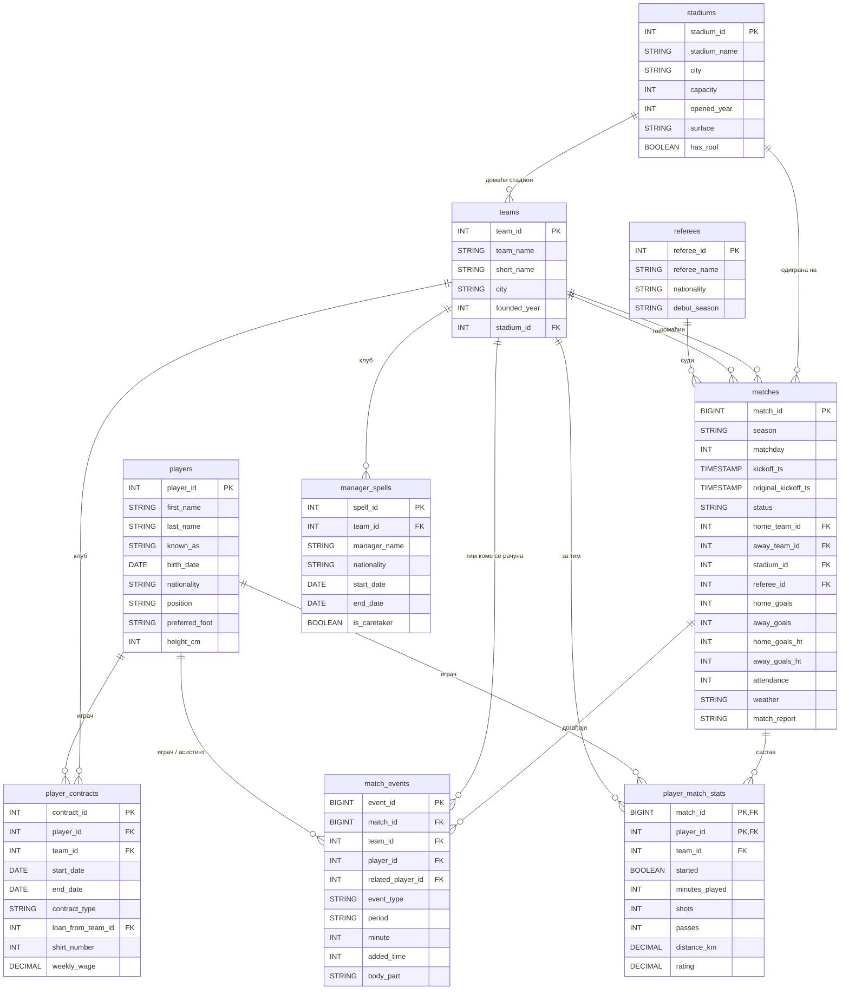

# Буткемп лига: табеле и колоне

Девет табела у шеми `bootcamp.northern_star`. Стрелице у дијаграму иду од табеле „један“ ка табели „више“: један клуб има много утакмица, једна утакмица има много догађаја.

## Преглед

| Табела | Један ред је | Редова |
| --- | --- | --- |
| `stadiums` | један стадион | 22 |
| `teams` | један клуб | 24 |
| `referees` | један судија | 20 |
| `players` | један играч | 681 |
| `player_contracts` | један уговор играча са клубом | 717 |
| `manager_spells` | један мандат тренера у клубу | 31 |
| `matches` | једна утакмица | 761 |
| `match_events` | један догађај на утакмици (гол, картон, измена) | ~11.000 |
| `player_match_stats` | један играч на једној утакмици (у саставу) | 30.440 |

## stadiums

| Колона | Тип | Кључ | Значење |
| --- | --- | --- | --- |
| `stadium_id` | INT | PK | Идентификатор стадиона |
| `stadium_name` | STRING | | Назив стадиона |
| `city` | STRING | | Град |
| `capacity` | INT | | Капацитет (број места) |
| `opened_year` | INT | | Година отварања |
| `surface` | STRING | | Подлога терена |
| `has_roof` | BOOLEAN | | Да ли стадион има кров |

## teams

| Колона | Тип | Кључ | Значење |
| --- | --- | --- | --- |
| `team_id` | INT | PK | Идентификатор клуба |
| `team_name` | STRING | | Назив клуба |
| `short_name` | STRING | | Скраћеница од три слова, нпр. NPU |
| `city` | STRING | | Град |
| `founded_year` | INT | | Година оснивања |
| `stadium_id` | INT | FK → stadiums | Домаћи стадион; NULL за клуб без стадиона |

## referees

| Колона | Тип | Кључ | Значење |
| --- | --- | --- | --- |
| `referee_id` | INT | PK | Идентификатор судије |
| `referee_name` | STRING | | Име и презиме |
| `nationality` | STRING | | Држављанство |
| `debut_season` | STRING | | Сезона првог суђења у лиги |

## players

| Колона | Тип | Кључ | Значење |
| --- | --- | --- | --- |
| `player_id` | INT | PK | Идентификатор играча |
| `first_name` | STRING | | Име |
| `last_name` | STRING | | Презиме |
| `known_as` | STRING | | Надимак, ако га има |
| `birth_date` | DATE | | Датум рођења |
| `nationality` | STRING | | Држављанство |
| `position` | STRING | | Позиција: GK, DF, MF, FW |
| `preferred_foot` | STRING | | Боља нога |
| `height_cm` | INT | | Висина у центиметрима |

## player_contracts

| Колона | Тип | Кључ | Значење |
| --- | --- | --- | --- |
| `contract_id` | INT | PK | Идентификатор уговора |
| `player_id` | INT | FK → players | Играч |
| `team_id` | INT | FK → teams | Клуб |
| `start_date` | DATE | | Почетак уговора |
| `end_date` | DATE | | Крај уговора; NULL ако још траје |
| `contract_type` | STRING | | Врста уговора, нпр. позајмица (`loan`) |
| `loan_from_team_id` | INT | FK → teams | Матични клуб, само код позајмице |
| `shirt_number` | INT | | Број на дресу |
| `weekly_wage` | DECIMAL(10,2) | | Недељна плата |

## manager_spells

| Колона | Тип | Кључ | Значење |
| --- | --- | --- | --- |
| `spell_id` | INT | PK | Идентификатор мандата |
| `team_id` | INT | FK → teams | Клуб |
| `manager_name` | STRING | | Тренер |
| `nationality` | STRING | | Држављанство тренера |
| `start_date` | DATE | | Први дан мандата |
| `end_date` | DATE | | Последњи дан мандата; NULL ако тренер још води клуб |
| `is_caretaker` | BOOLEAN | | Привремени тренер после смене |

## matches

| Колона | Тип | Кључ | Значење |
| --- | --- | --- | --- |
| `match_id` | BIGINT | PK | Идентификатор утакмице |
| `season` | STRING | | Сезона, нпр. '2024/25' |
| `matchday` | INT | | Коло (1–38) |
| `kickoff_ts` | TIMESTAMP | | Почетак утакмице (UTC) |
| `original_kickoff_ts` | TIMESTAMP | | Првобитни термин; NULL ако утакмица није одлагана |
| `status` | STRING | | `played` или `abandoned` |
| `home_team_id` | INT | FK → teams | Домаћин |
| `away_team_id` | INT | FK → teams | Гост |
| `stadium_id` | INT | FK → stadiums | Стадион на ком је одиграна |
| `referee_id` | INT | FK → referees | Судија |
| `home_goals` | INT | | Голови домаћина; NULL за прекинуту утакмицу |
| `away_goals` | INT | | Голови госта; NULL за прекинуту утакмицу |
| `home_goals_ht` | INT | | Голови домаћина на полувремену |
| `away_goals_ht` | INT | | Голови госта на полувремену |
| `attendance` | INT | | Посета; NULL ако није пријављена, 0 без публике |
| `weather` | STRING | | Време: clear, rain, wind, fog, snow; NULL ако није забележено |
| `match_report` | STRING | | Наслов о утакмици; може бити NULL |

## match_events

| Колона | Тип | Кључ | Значење |
| --- | --- | --- | --- |
| `event_id` | BIGINT | PK | Идентификатор догађаја |
| `match_id` | BIGINT | FK → matches | Утакмица |
| `team_id` | INT | FK → teams | Тим коме се догађај рачуна (код аутогола: тим коме је гол признат) |
| `player_id` | INT | FK → players | Играч који је направио догађај |
| `related_player_id` | INT | FK → players | Асистент код гола, играч који излази код измене; иначе NULL |
| `event_type` | STRING | | `goal`, `penalty_goal`, `penalty_miss`, `own_goal`, `yellow_card`, `second_yellow`, `red_card`, `substitution` |
| `period` | STRING | | Полувреме: `1H` или `2H` |
| `minute` | INT | | Минут |
| `added_time` | INT | | Минут надокнаде; NULL ако догађај није у надокнади |
| `body_part` | STRING | | Део тела код гола, нпр. `head` |

## player_match_stats

| Колона | Тип | Кључ | Значење |
| --- | --- | --- | --- |
| `match_id` | BIGINT | PK, FK → matches | Утакмица |
| `player_id` | INT | PK, FK → players | Играч |
| `team_id` | INT | FK → teams | Тим за који је играо на тој утакмици |
| `started` | BOOLEAN | | Да ли је почео утакмицу |
| `minutes_played` | INT | | Одиграни минути; 0 ако није улазио у игру |
| `shots` | INT | | Шутеви |
| `passes` | INT | | Додавања |
| `distance_km` | DECIMAL(4,1) | | Пређени километри |
| `rating` | DECIMAL(3,1) | | Оцена играча; NULL ако није оцењен |

Кључ табеле `player_match_stats` је сложен: `match_id` и `player_id` заједно.

## Напомене

- PRIMARY KEY и FOREIGN KEY у Databricks-у су информативни: база их не проверава. Зато у подацима постоје, на пример, догађаји са играчем 99999 којег нема у `players`.
